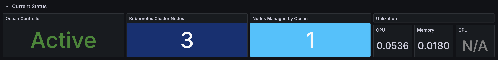
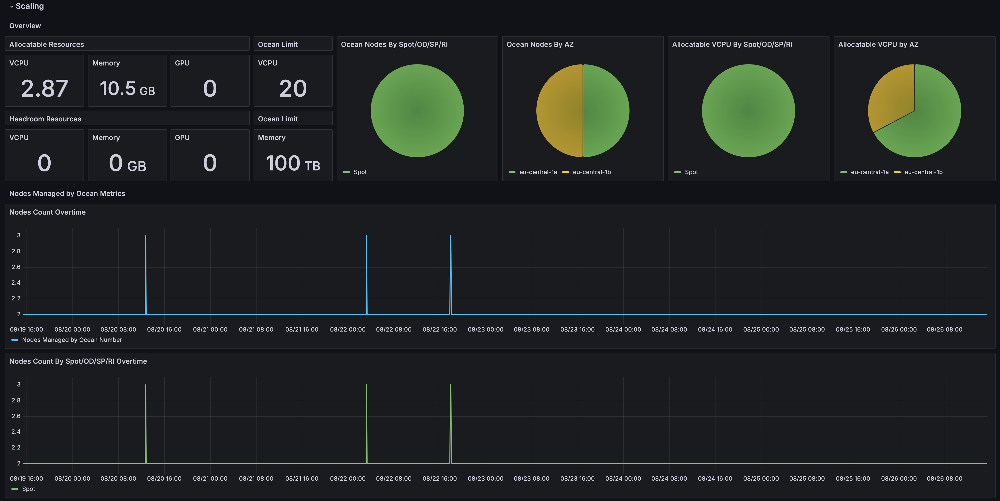
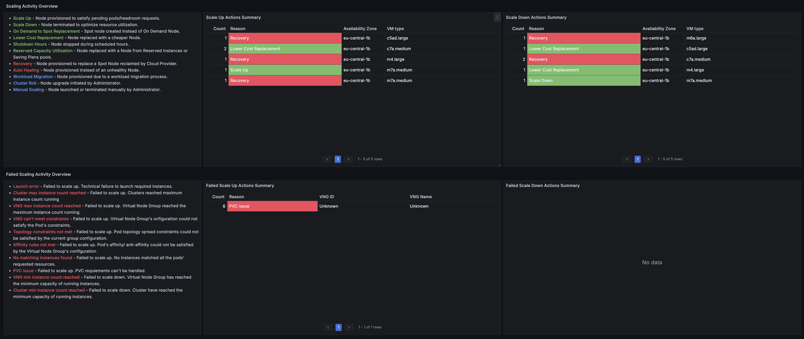

# Spot Ocean Scaling Dashboard

This dashboard provides real-time insights into the scaling, usage, and right-sizing activities managed by Spot Ocean within your Kubernetes cluster. It showcases metrics related to node provisioning, optimization, and recovery operations. The visualizations help you understand how Spot Ocean dynamically manages Kubernetes cluster resources to ensure optimal performance, and high availability. Key actions such as scale-ups, scale-downs, node replacements, and manual interventions are highlighted to give a comprehensive view of your cluster’s operational status and health.

It includes comprehensive data on compute, storage, and networking expenses, helping you monitor and optimize cloud spending. Visualizations highlight the track usage patterns over time. This information empowers customers to make informed decisions about resource allocation, and ensure efficient utilization of cloud infrastructure. Additionally, the dashboard enables the evaluation of Ocean’s right-sizing capability, demonstrating how efficient resource adjustments contribute to cost reduction while maintaining optimal cluster performance.

## Introduction

Spot Ocean (https://spot.io/product/ocean/) manages the scaling of the Kubernetes data plane, and the data generated in the process can be valuable for monitoring your containerized environment. Using well-defined Prometheus metrics for monitoring Ocean helps you understand cluster scaling and debug any issues that may arise. In addition, you can build alerts based on the metrics to address issues in real-time and track important trends on a dashboard of different Ocean metrics.

Ocean maintains an official set of metrics, natively scrapable by Prometheus. This set of metrics helps build a 360-degree view of Ocean's actions while providing application-driven infrastructure.

## Variables

- **Datasource**: Select the cluster datasource in a Grafana installation with multiple datasources available.
- **Ocean Cluster ID**: Filter data only for the selected ID, suitable for datasources with data from several Ocean clusters.
- **Aggregation Interval**: Used to set a relative time in panels with aggregated data. The relative time will be shown on the panel title.

## Metrics

By monitoring the following key metrics, you can understand how Ocean scales.

### Current Status

- Ocean controller status. Source: Ocean.
- Kubernetes cluster Nodes. Source: Kubernetes API server.
- Nodes managed by Ocean. Source: Ocean.
- Cluster resources utilization. Source: Ocean.

### Scaling

#### Overview

- Cluster nodes' allocatable resources (CPU, memory, GPU). Source: Ocean.
- Ocean cluster headroom allocatable resources (CPU, memory, GPU). Source: Ocean.
- Ocean cluster resources limit (CPU, memory). Source: Ocean.
- Ocean nodes breakdown by instance lifecycle and availability zone. Source: Ocean.
- Cluster nodes' allocatable resources breakdown by instance lifecycle and availability zone. Source: Ocean.

#### Nodes Managed by Ocean Metrics

- Ocean nodes count over time. Source: Ocean.
- Ocean nodes count by instance lifecycle and availability zone over time. Source: Ocean.
- Cluster nodes' allocatable resources count by instance lifecycle and availability zone over time. Source: Ocean.

#### Resources Utilization Metrics

- Cluster resources (CPU, memory, GPU) utilization over time. Source: Ocean.

#### Pods Metrics

- Average time for Pod to become ready over time. Source: Kubernetes API server.
- Pods in Running state. Source: Kubernetes API server.

#### Scaling Activity Overview

- Scaling up and down events summaries. Source: Ocean.
- Nodes Added Over Time. Source: Ocean.
- Nodes Removed Over Time. Source: Ocean.
- Failed scaling up and down events summaries. Source: Ocean.
- Failed Scales Up Overtime. Source: Ocean.

#### Ocean Controllers Metrics

- Ocean Kubernetes controller status over time. Source: Ocean.
- Ocean Kubernetes controllers pods over time. Source: Kubernetes API server.
- Ocean Kubernetes controllers memory consumption over time. Source: Kubernetes API server.
- Ocean metrics controllers memory consumption over time. Source: Kubernetes API server.

### Right-Sizing Metrics

- VCPU Suggestions Overtime. Source: Ocean.
- Memory Suggestions Overtime. Source: Ocean.
- Top 5 Workloads with Potential Monthly Max. Savings. Source: Ocean.

Ocean metrics are relevant to Ocean Prometheus Exporter for EKS, AKS, and GKE.

More information at https://docs.spot.io/ocean/tools-and-integrations/prometheus/

## Cluster Dependencies / Prerequisites

- Ocean controller. More information at https://docs.spot.io/ocean/overview-kubernetes
- Ocean network client. More information at https://docs.spot.io/ocean/tutorials/install-network-client-v2
- Ocean metric exporter. More information at https://docs.spot.io/ocean/tools-and-integrations/prometheus/scrape
- kube-state-metrics service.
- Prometheus server.

## Conclusion 

The Spot Ocean Scaling Dashboard is a powerful tool for understanding and optimizing your Kubernetes clusters. By leveraging Prometheus and Grafana, you can gain deep insights into how Spot Ocean manages your infrastructure, helping you make informed decisions that lead to better performance. Whether you’re tracking scaling events or evaluating right-sizing adjustments, this dashboard provides the comprehensive data you need to maintain an efficient and high-performing Kubernetes environment. 

## Next Plans

- Continues optimization

